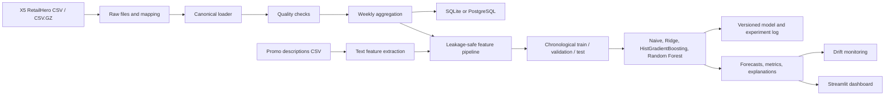

# Архитектура

Проект прогнозирует недельные продажи товарных категорий в разрезе магазина и категории. Поток разделен на загрузку источников, проверку качества, хранение, подготовку признаков, обучение, расчет прогнозов и представление результатов.

## Поток обработки

1. `downloader` находит локальные данные или загружает публичный набор X5; синтетический режим маркируется отдельно.
2. `x5_loader` обрабатывает вложенные CSV и gzip, приводит названия полей к единой схеме и присоединяет категории товаров.
3. `quality` проверяет обязательные поля и допустимость значений, сохраняя отказы в отдельный набор.
4. `aggregation` формирует недельные ряды с понедельником в качестве начала недели. Запись выполняется через ключи и режим upsert.
5. `features` строит лаги, скользящие агрегаты, календарные признаки и текстовые промо-признаки без использования будущих продаж.
6. Временное разбиение отделяет обучение, подбор модели и окончательную оценку.
7. `pipeline` создает прогнозы 1–4 недель, метрики, объяснения и отчеты о дрейфе.
8. Streamlit показывает фактические продажи, прогнозы, качество и мониторинг.

## Хранение и сервисы

Локальный режим использует SQLite и CSV-артефакты. Основной контейнерный режим задается `docker-compose.yml`: PostgreSQL хранит данные, приложение исполняет пайплайн, а Streamlit открывает дашборд. SQL-структура находится в `sql/001_schema.sql`. Контейнерный режим реализован, но в рамках этой проверки не запускался.
