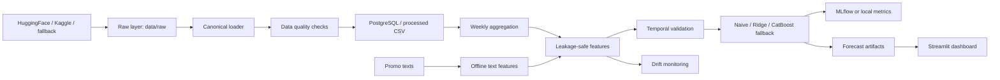

# Архитектура

Проект реализует локальный ML-контур для прогноза недельных продаж по товарным категориям. Основной источник - X5 RetailHero. Если публичные источники недоступны, создается явно помеченный синтетический fallback с той же канонической схемой.

## Сервисы

- `postgres`: хранит raw-транзакции, недельные агрегаты, промо-тексты, прогнозы, метрики и журналы.
- `app`: выполняет загрузку, ETL, обучение и мониторинг.
- `dashboard`: показывает факт, метрики, промо-недели и сравнение категорий.

## Потоки данных

1. `scripts/download_x5_dataset.py` проверяет локальные файлы и скачивает X5 RetailHero или создает fallback.
2. `x5_loader` приводит разные исходные имена колонок к канонической схеме.
3. `quality` отделяет проблемные записи.
4. `aggregation` строит `weekly_sales` с неделей, начинающейся в понедельник.
5. `features` создает лаги, rolling-признаки, календарь и текстовые промо-признаки без утечки.
6. `models` обучает baseline, линейную модель и бустинг.
7. `monitoring` считает PSI и метрики качества.
